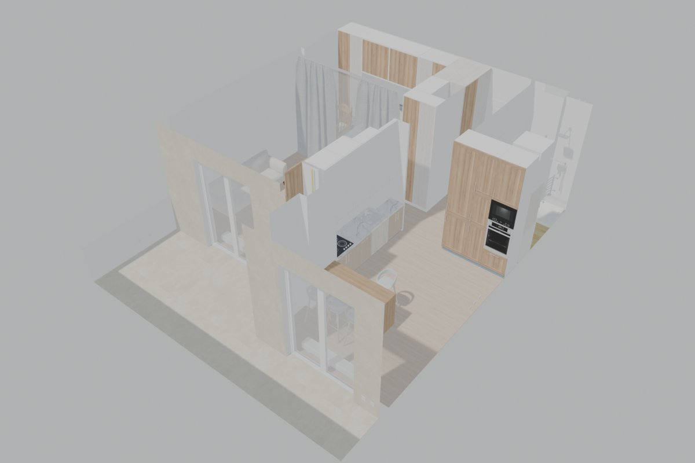
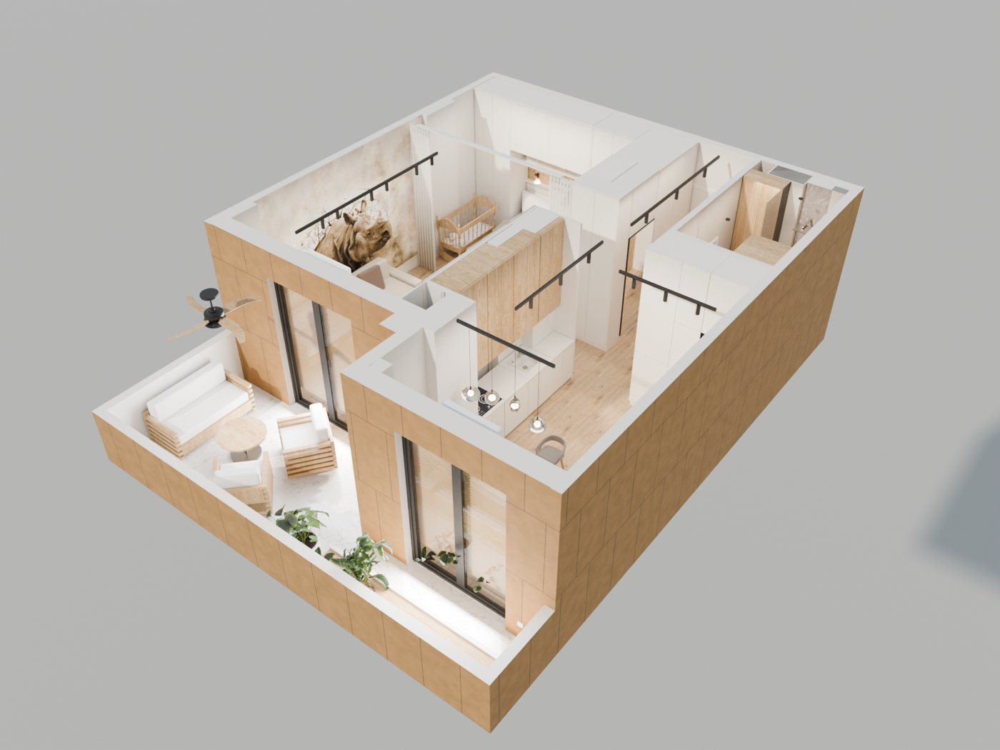
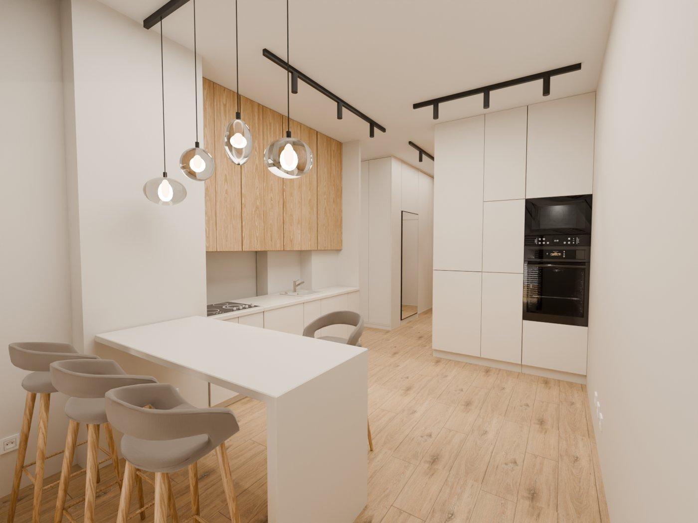
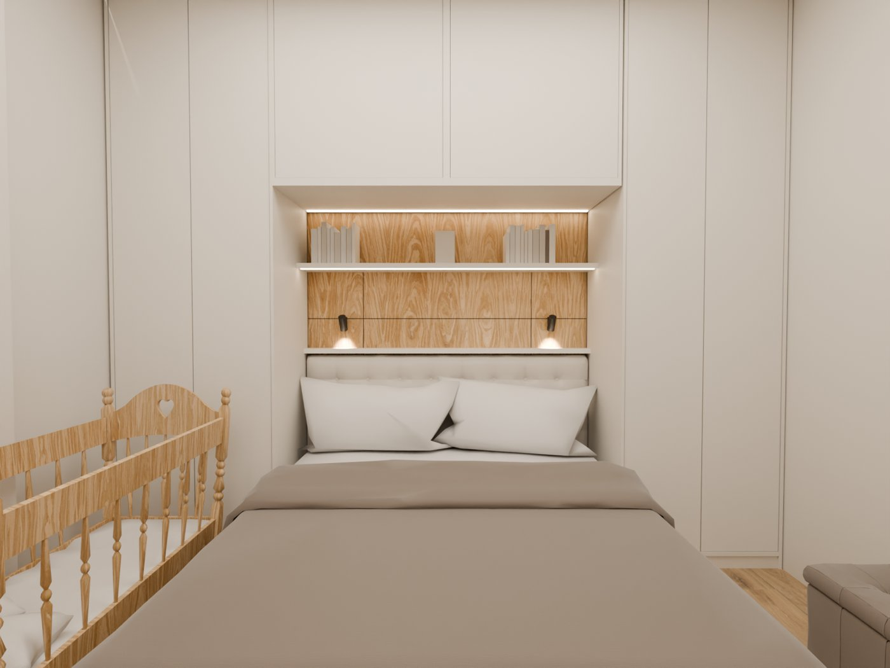
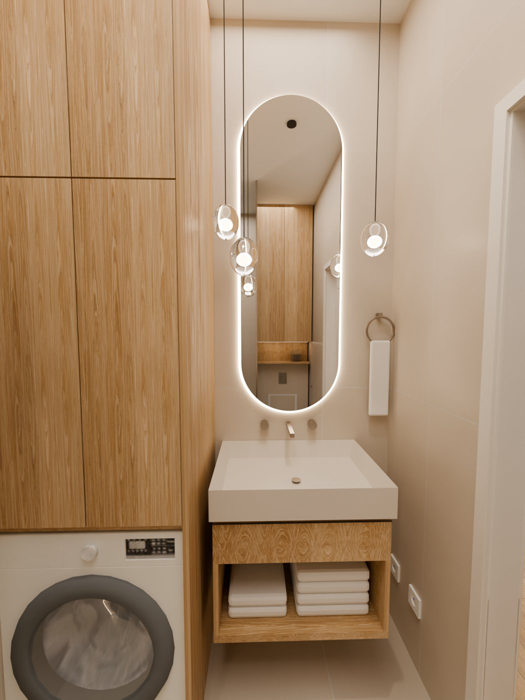

# interior-restyle

**English** · [Русский](README.ru.md)

A [Claude Code](https://claude.com/claude-code) skill that takes the 3D model of an apartment layout (exported
from an online floor planner) plus images of the interior design you like, rebuilds the apartment in that style in
**Blender**, and produces the visualization: per-room renders, a PDF presentation and a walkthrough video.

You talk to Claude in plain language ("apply this design to the new layout", "make the bathroom like on these
renders", "swap the floor for this laminate from the catalog", "render a walkthrough"). The skill gives Claude the
workflow, a tested Blender library and the hard-won fixes for Blender/Cycles pitfalls, so the result is
reproducible and every change can be re-applied with one command.

| Before: raw planner export | After: restyled scene |
|---|---|
|  |  |

| Kitchen | Bedroom | Bathroom |
|---|---|---|
|  |  |  |

---

## What it does

- **Reads your scene.** Lists every object of the planner export with its dimensions, renders a top-down plan
  and an isometric view, and maps the rooms of the old design onto the new layout.
- **Asks before it builds.** Clarifying questions one at a time: may furniture be moved or only restyled, repaint
  or replace objects, where textures come from, what you want as output.
- **Restyles the apartment in Blender** through a project build script, so every decision is code:
  - materials from free CC0 [Poly Haven](https://polyhaven.com) textures (downloaded only after you say yes);
  - colors matched to swatches from your supplier's catalog (veneer, panels);
  - laminate/parquet from a photo of the catalog sample, cropped to whole plank rows;
  - tiles of an exact size (e.g. vertical 60 × 120 cm, stacked or offset), marble veins;
  - photo wallpaper on a wall from column to column;
  - flat handleless fronts instead of the planner's shaker fronts, built-in niches, TV walls, open curtains,
    floor-recessed convectors, walk-in shower with fluted glass, floating stone sink, LED strips, track lights.
- **Renders** with Cycles on the GPU: quick previews first, then final frames; portrait frames for bathrooms;
  isometric views (from the windows and from the entrance) and an orthographic plan.
- **Iterates efficiently.** After each change it re-renders **only the views that actually see the change**
  and tells you the render time before any long job.
- **Builds a PDF** presentation: cover, one section per room, a caption with materials under every image.
- **Makes a walkthrough video** along a route you agree on: smooth spline camera with a walking-speed and
  head-turn limit, motion blur, EEVEE draft first, Cycles final.

## Requirements

| | |
|---|---|
| Claude Code | the skill uses local tools (Blender, Python, ffmpeg), so it is for Claude Code, not claude.ai |
| Blender 5.x | tested with **5.2.2 on macOS (Apple Silicon, Metal)**; `blender` must be on `PATH` |
| Python 3 + Pillow, reportlab | only for contact sheets and the PDF (Claude creates a throwaway venv) |
| ffmpeg | only for the walkthrough video (`brew install ffmpeg`) |

## Installation

```bash
git clone https://github.com/okirasov/interior-restyle.git ~/.claude/skills/interior-restyle
```

That's it: Claude Code picks up skills from `~/.claude/skills/` in every project. To update later:
`git -C ~/.claude/skills/interior-restyle pull`.

## Usage

Put your files in a project folder and open Claude Code there. Example requests:

- "Here is the new layout in 3D (`scene.glb`) and renders of the design made for the old layout in `refs/`.
  Apply this design to the new layout. Ask me questions."
- "Make the floor this laminate from the catalog" *(attach a photo of the sample)*.
- "Behind the sofa, put photo wallpaper from column to column" *(attach the image)*.
- "Tiles in the bathroom are 120 cm high and 60 cm wide."
- "Make the bathroom exactly like on these renders" *(attach images)*.
- "Collect the finished renders into a PDF."
- "Can you make a walkthrough video? Let's discuss the route."

### What you provide

| Input | Required |
|---|---|
| 3D scene of the new layout (GLB/GLTF, FBX, OBJ or .blend), e.g. exported from an online planner | yes |
| Style references: renders or photos of the design | yes |
| Plan of the old apartment (if the references were made for another layout) | recommended |
| Catalog swatches: floor, wall panels, tiles (with sizes) | optional |
| Photos or 3D files of specific products (sofa, wallpaper, fixtures) | optional |

### Options Claude will ask about

- **Layout:** keep 100% / allow built-in furniture / allow moving things.
- **Objects:** repaint the existing ones / replace with detailed models (each one approved by you).
- **Textures:** Poly Haven (with confirmation) / procedural only / your catalog samples.
- **Output:** which rooms, PDF, video (duration, draft or final).
- **Quality:** see the table below.

### Ground rules built into the skill

- Nothing is downloaded without your explicit yes (file, source, license, size are listed first).
- No object is replaced by another model without your approval.
- Only affected views are re-rendered; long renders are announced with an estimate and run in the background.
- The layout is not changed unless you allow it.

## How it works

1. **Inspect** — `scripts/inspect_scene.py` lists objects with bounds and renders a plan; Claude studies the
   references and maps old rooms onto the new layout.
2. **Interview** — one question at a time, grounded in what it found; a summary you approve.
3. **Pilot frames** — style tuned on 1–2 rooms (preview → final) until you confirm it matches.
4. **All rooms** — cameras for every room, plan and isometric views; previews as contact sheets, then finals.
5. **Changes** — every change goes into the project build script; only affected views are re-rendered.
6. **PDF** — `scripts/make_pdf.py` from a small JSON config.
7. **Video** — route in JSON → `--analyze` (speed/turn check) → key stills → EEVEE draft → Cycles final.

The scene for each apartment is built by a project script (`<project>/scripts/build_scene.py`) that Claude
writes on top of the shared library `scripts/scene_lib.py`. Coordinates are specific to each apartment; materials,
geometry helpers, lights, cameras and render setup are shared.

## Repository layout

```
interior-restyle/
├── SKILL.md                  # the workflow and rules Claude follows (instructions are in Russian)
├── scripts/
│   ├── scene_lib.py          # Blender library: import, materials, geometry, lights, cameras, render
│   ├── inspect_scene.py      # object list with bounds + plan/isometric images of a planner export
│   ├── contact_sheet.py      # several renders on one image for quick review
│   ├── make_pdf.py           # PDF presentation from a JSON config
│   └── walkthrough.py        # walkthrough video with a smooth, speed-limited camera
├── references/
│   ├── pitfalls.md           # known Blender 5.x / Cycles problems and fixes
│   ├── materials.md          # material recipes, catalog color matching, Poly Haven API
│   ├── planner_objects.md    # what the planner's object names mean (fronts, handles, carcasses)
│   └── video.md              # walkthrough route, smoothness, render time
└── docs/images/              # images for this README
```

### Scripts on their own

```bash
# inspect a planner export
blender -b --python scripts/inspect_scene.py -- scene.glb out_dir/

# contact sheet / PDF (Python with Pillow + reportlab; always run with -I)
python -I scripts/contact_sheet.py sheet.jpg renders/*.png --cols 3
python -I scripts/make_pdf.py pdf_config.json renders.pdf

# walkthrough: check the motion, key stills, draft, final
blender -b --python scripts/walkthrough.py -- route.json --analyze
blender -b --python scripts/walkthrough.py -- route.json --stills --res 480 --samples 8
blender -b --python scripts/walkthrough.py -- route.json --res 960 --samples 32 --name draft
blender -b --python scripts/walkthrough.py -- route.json --engine cycles --res 1280 --samples 96 --name final
```

Config formats are documented at the top of each script.

## Render times

Measured on a Mac with M4 Pro (20-core GPU), Cycles on Metal with kernel optimization off:

| Mode | Settings | Per frame |
|---|---|---|
| Preview | 640–800 px, 24–32 samples | 2–5 s |
| Standard | 1600 × 1200, 256 samples | ~70 s |
| High | 2560 × 1920, 512 samples | ~6 min |
| 4K | 3840 × 2880, 1024 samples | ~25 min |
| Video draft | EEVEE 960 × 540 | ~1.5 s |
| Video final | Cycles 1280 × 720, 96 samples | ~11 s |

## Known pitfalls it handles

- Blender 5.2 crashing on Metal while compiling specialized kernels (`kernel_optimization_level = OFF`).
- Black ceiling patches from overlapping coplanar planes.
- Shower/window glass rendering black (Fresnel on the back side of thin glass).
- Distorted bevels on scaled boxes; blue-tinted linen texture; area lights showing up as black rectangles.
- Jerky walkthrough camera (whip turns, stop-and-go, no motion blur).

Details: [`references/pitfalls.md`](references/pitfalls.md).

## Limitations

- Furniture that Claude builds from simple shapes, and the planner's catalog models, look simplified at 4K.
  For high-end renders, replace key items with detailed models first.
- Object-name rules in `references/planner_objects.md` were written for one online planner's GLB export; other
  sources work, but Claude will map their objects from scratch.
- The skill instructions (`SKILL.md`, `references/`) are written in Russian. Claude follows them fine and answers
  in your language.

## License

[MIT](LICENSE)
